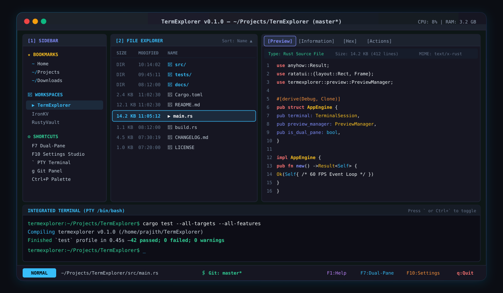

# 🚀 TermExplorer

**Your terminal. Your workspace. Your rules.**

A high-performance, keyboard-driven Linux developer environment written in pure Rust. Combines a dual-pane file explorer, code editor, interactive PTY terminal, live system monitor, Git dashboard, and universal multi-format preview engine into one unified TUI.

[](https://github.com/jyothiprajith1323/TermExplorer/actions/workflows/ci.yml)
[](https://jyothiprajith1323.github.io/TermExplorer/)
[](https://github.com/jyothiprajith1323/TermExplorer/releases)
[](https://www.rust-lang.org/)
[](https://opensource.org/licenses/MIT)
[]()
[]()

🌐 **Official Website & Docs:** [https://jyothiprajith1323.github.io/TermExplorer/](https://jyothiprajith1323.github.io/TermExplorer/)

---

## 📸 Interface Overview

<p align="center">
  
</p>

```text
┌── EXPLORER (25%) ──┬── PREVIEW / INSPECTOR (75%) [Preview|Info|Hex|Actions] ──────────────┐
│ SIZE   NAME        │ Type: Rust Source File (14.2 KB)                                     │
│ DIR    src/        │  1  use anyhow::Result;                                              │
│ DIR    tests/      │  2  use ratatui::widgets::Paragraph;                                 │
│ 2.4 KB Cargo.toml  │  3                                                                   │
│ 12 KB  README.md   │  4  #[derive(Debug, Clone)]                                          │
│ 14 KB >main.rs     │  5  pub struct AppEngine {                                           │
│  1 KB  build.rs    │  6      pub terminal: TerminalSession,                               │
│                    │  7  }                                                                │
├────────────────────┴──────────────────────────────────────────────────────────────────────┤
│ termexplorer:~/Projects/TermExplorer$ cargo test --all-targets --all-features             │
│    Finished `test` profile in 0.45s — 99 passed; 0 failed; 0 warnings                     │
└───────────────────────────────────────────────────────────────────────────────────────────┘
 NORMAL  ~/Projects/TermExplorer/src/main.rs | Git: master* | F1:Help F10:Settings Ctrl+T:Term q:Quit
```

---

## ✨ Key Subsystems & Features

### 1. 👁️ Universal Multi-Format Preview Engine (`src/preview/`)
- **4 Dedicated Inspector Tabs:** `[Preview]`, `[Information]`, `[Hex]`, and `[Actions]`.
- **Magic-Byte Sniffer:** Sniffs file signatures directly to prevent incorrect MIME mapping.
- **Source Code:** Full syntax highlighting via `syntect` with line numbers and bounded memory reads.
- **Markdown:** Renders headers, lists, code fences, blockquotes, checklists, and auto-extracted Table of Contents.
- **Images:** 24-bit Truecolor half-block (`▀`) pixel rendering for PNG, JPEG, GIF, WebP, BMP, and dimension parsing for SVG.
- **Video Containers:** Extracts duration, resolution, codecs, bitrate via `ffprobe`, and first-frame thumbnails via `ffmpeg`.
- **Audio Media:** Inspects sample rate, duration, channels, ID3 tags (artist, title, album), and detects CLI audio players.
- **PDF Documents:** Pure-Rust catalog header parser (page count, title, author) & extracted text stream via `pdftotext`.
- **Pure-Rust Office Documents:** Direct XML parsing from ZIP packages for `.docx` paragraphs, `.xlsx` shared strings/cells, and `.pptx` slide counts (no LibreOffice required).
- **Tabular Data:** Delimiter sniffer for CSV/TSV with column alignments, and JSON pretty-printer with syntax error indicators.
- **Archives:** Nested index table for `.zip`, `.tar`, and `.tar.gz` with compression ratios and path traversal safety checks.
- **SQLite 3 Databases:** Header decoding (page size, version, change count), `sqlite_master` schema browser, and row sampler.
- **Canonical Hex Viewer:** 16-byte hex dump with memory offset, hex byte pairs, and printable ASCII pane.
- **LRU Cache:** Bounded in-memory preview cache (max 64 MB / 100 entries) preventing repeated disk reads.

### 2. ⚡ Dual-Pane Explorer & FreeDesktop Trash
- **Dual-Pane View (`F7`):** Side-by-side file managers with independent navigation, selections, and sorting.
- **Cross-Pane Transfers:** Copy files to the opposing pane with `c`, move with `m`.
- **FreeDesktop Trash (`d`):** Safely moves deleted items to FreeDesktop Trash (`gio trash` / `trash-put`) before permanent deletion (`D`).
- **Sidebar & Bookmarks (`b` / `p`):** Pin folders, access Linux shortcuts (`Home`, `Root`, `Downloads`, `/etc`), and manage workspaces.

### 3. 🎛️ Interactive Settings Studio (`F10`)
- **15 Configuration Sections:** General, Appearance, Keybindings, Explorer, Preview, Editor, Terminal, System Monitor, Git, Bookmarks, Profiles, Performance, Plugins, Advanced, About.
- **Keybinding Conflict Detection:** Scoped key action registry flags clashing shortcuts automatically.
- **6 Built-in Profiles:** `Default`, `Developer`, `Minimal`, `TerminalPowerUser`, `EditorFocus`, and `Monitoring`.
- **Resilient Persistence:** Configuration boundary clamping and atomic `.toml.bak` backup recovery.

### 4. 🎨 12 Built-in Themes & Transparency
- **Included Themes:** Catppuccin Mocha, Catppuccin Macchiato, Dracula, Nord, Gruvbox, Tokyo Night, One Dark, Solarized Dark, Solarized Light, Monokai, Default Dark, Default Light.
- **Terminal Transparency:** Seamless inheritance of your terminal emulator's background and blur settings (`bg: None`).

### 5. 💻 Embedded Interactive PTY Terminal
- Real pseudo-terminal powered by `portable-pty` spawning `$SHELL` (or Bash).
- Preserves native shell completions, aliases, prompts, and job control.
- Non-blocking channel I/O eliminates rendering locks.

### 6. ✏️ Advanced Rope-Backed Code Editor & Autocomplete Engine
- **Rope Text Buffer (`ropey`):** Handles large source files with instantaneous insertions, deletions, and character-safe indexing.
- **4-Layer Autocomplete:** Layer 1 buffer words, Layer 2 async workspace symbol indexer (<26 ms), Layer 3 language snippets, and Layer 4 LSP queries.
- **Syntax Highlighting & Formatting:** Viewport-bounded syntax tokenization across 20+ programming languages.
- **Visual Selection & Comments:** Visual block selection, search/replace (`F3`), and multi-language line comments (`Ctrl+/`).
- **Unicode & Emoji Precision:** True display-width slicing and zero-panic multibyte UTF-8 handling.
- **Data Protection:** Multi-level Undo/Redo (300 entries), unsaved buffer recovery snapshots, and atomic POSIX disk flushes (`sync_all`).

### 7. 📊 System Monitor & Git Dashboard
- **System Monitor (`m`):** Per-core CPU load, memory utilization, swap, disk capacity, and live top processes.
- **Git Dashboard (`g`):** Branch tracking, staged/unstaged views, recent commit history, and inline staging (`s`).
- **Command Palette (`Ctrl+Shift+P` / `P`):** Fuzzy-search internal actions, panel toggles, and bookmarks.
- **Onboarding Wizard (`F1`):** Interactive 5-step walkthrough on first launch.

---

## ⌨️ Essential Keyboard Shortcuts

| Shortcut | Context | Action |
|---|---|---|
| <kbd>Tab</kbd> / <kbd>Shift+Tab</kbd> | Global | Cycle focus forward / backward across active panels |
| <kbd>Ctrl+P</kbd> / <kbd>Ctrl+Shift+P</kbd> | Global | Open fuzzy-search Command Palette |
| <kbd>Ctrl+,</kbd> / <kbd>F10</kbd> | Global | Open Interactive Settings Studio |
| <kbd>Ctrl+Shift+X</kbd> | Global | Open Plugin Marketplace & Extension Center |
| <kbd>F1</kbd> / <kbd>?</kbd> | Global | Open Keyboard Shortcuts Reference Matrix |
| <kbd>Ctrl+G</kbd> / <kbd>g</kbd> | Global / Explorer | Open Git Workbench (branch status, diffs, stage `s`, commit `c`) |
| <kbd>F6</kbd> / <kbd>Ctrl+M</kbd> | Global | Toggle live System Telemetry Monitor |
| <kbd>F7</kbd> | Global | Toggle Dual-Pane side-by-side file manager |
| <kbd>F11</kbd> / <kbd>z</kbd> | Global / Browse | Toggle Fullscreen Preview (100% workstation width) |
| <kbd>Ctrl+Right</kbd> / <kbd>Alt+]</kbd> | Global | Expand Contextual Preview width (+5%, up to 85%) |
| <kbd>Ctrl+Left</kbd> / <kbd>Alt+[</kbd> | Global | Shrink Contextual Preview width (-5%, down to 15%) |
| <kbd>Ctrl+T</kbd> / <kbd>`</kbd> | Global | Toggle embedded PTY terminal drawer (15% height, hidden by default) |
| <kbd>Ctrl+Up</kbd> / <kbd>Ctrl+Down</kbd> | Global / Terminal | Resize bottom terminal drawer height (+/- 2 rows) |
| <kbd>Ctrl+B</kbd> | Global | Toggle Workspace Sidebar & Bookmarks |
| <kbd>F12</kbd> | Global | Toggle Performance Diagnostics & Frame Latency overlay |
| <kbd>Ctrl+Q</kbd> | Global | Cleanly terminate all child sessions and exit to shell |
| <kbd>↓</kbd> / <kbd>↑</kbd> (or <kbd>j</kbd>/<kbd>k</kbd>) | Explorer | Move selection down / up in directory |
| <kbd>→</kbd> / <kbd>Enter</kbd> / <kbd>l</kbd> | Explorer | Navigate into directory (or preview file) |
| <kbd>←</kbd> / <kbd>Backspace</kbd> / <kbd>h</kbd> | Explorer | Navigate out to parent directory |
| <kbd>/</kbd> / <kbd>Ctrl+F</kbd> | Global | Open Unified Workspace Fuzzy File Search modal |
| <kbd>Ctrl+Shift+F</kbd> | Global | Open Unified Full-Text Regex Content Grep modal |
| <kbd>+</kbd> / <kbd>-</kbd> / <kbd>0</kbd> | Preview (Image) | Zoom in / Zoom out / Reset zoom (24-bit Truecolor half-blocks) |
| <kbd>f</kbd> | Preview (Image) | Toggle fit-to-panel vs original-scale image preview |
| <kbd>[</kbd> / <kbd>]</kbd> | Preview (Video) | Step to previous / next extracted video frame |
| <kbd>g</kbd> / <kbd>m</kbd> | Preview (Video) | Jump to beginning (1s) / 50% midpoint frame |
| <kbd>n</kbd> / <kbd>p</kbd> | Preview (PDF) | Navigate to next / previous page |
| <kbd>Space</kbd> | Explorer | Focus directly into Contextual Preview |
| <kbd>/</kbd> | Explorer | Real-time fuzzy filter files |
| <kbd>.</kbd> / <kbd>Ctrl+H</kbd> | Explorer | Toggle hidden dotfiles |
| <kbd>s</kbd> | Explorer | Cycle sort order (Name, Size, Modified, Type) |
| <kbd>a</kbd> / <kbd>F4</kbd> | Explorer | Create new file with prompt |
| <kbd>A</kbd> / <kbd>F7</kbd> | Explorer | Create new directory with prompt |
| <kbd>r</kbd> | Explorer | Rename selected file or directory |
| <kbd>d</kbd> / <kbd>F8</kbd> / <kbd>Del</kbd> | Explorer | Move selected item to FreeDesktop Trash (with confirmation) |
| <kbd>c</kbd> / <kbd>y</kbd> | Explorer | Copy item to clipboard |
| <kbd>x</kbd> | Explorer | Cut item to clipboard |
| <kbd>v</kbd> / <kbd>p</kbd> | Explorer | Paste clipboard item into directory |
| <kbd>F5</kbd> | Explorer | Refresh directory tree and reload Git status |
| <kbd>1</kbd> / <kbd>2</kbd> / <kbd>3</kbd> / <kbd>4</kbd> | Preview | Jump directly to Preview, Info, Metadata/Hex, or Actions tab |
| <kbd>[</kbd> / <kbd>]</kbd> | Preview | Cycle active preview tab |
| <kbd>1</kbd>–<kbd>9</kbd> | Preview (Actions) | Execute contextual action (Open with, Extract, Play) |
| <kbd>F2</kbd> / <kbd>Enter</kbd> | Explorer / Preview | Open highlighted file in integrated code editor |
| <kbd>Ctrl+Space</kbd> | Editor | Manually trigger 4-layer autocomplete popup |
| <kbd>Ctrl+/</kbd> / <kbd>Ctrl+_</kbd> | Editor | Toggle line comments in code |
| <kbd>F3</kbd> / <kbd>Shift+F3</kbd> | Editor | Find next / previous search match |
| <kbd>Ctrl+S</kbd> | Editor | Save buffer to disk atomically with directory synchronization |
| <kbd>Ctrl+Z</kbd> / <kbd>Ctrl+Y</kbd> | Editor | Multi-level Undo / Redo |
| <kbd>Tab</kbd> | Editor | Accept autocomplete suggestion or indent |
| <kbd>Esc</kbd> | Any | Universal escape: exit editor/modal and return focus to Explorer |

*For the complete keybinding matrix, see [KEYBINDINGS.md](docs/KEYBINDINGS.md).*

---

## 📦 Installation & Getting Started

### Option 1: Automated Shell Installer (Recommended)
```bash
curl -fsSL https://raw.githubusercontent.com/jyothiprajith1323/TermExplorer/master/install.sh | bash
```

### Option 2: Arch Linux (AUR)
```bash
yay -S termexplorer-bin
```

### Option 3: Install via Cargo
```bash
cargo install --git https://github.com/jyothiprajith1323/TermExplorer.git --locked
```

### Option 4: Build from Source
```bash
git clone https://github.com/jyothiprajith1323/TermExplorer.git
cd TermExplorer
cargo build --release
install -Dm755 target/release/termexplorer ~/.local/bin/termexplorer
```

For package prerequisites and multimedia helpers (`ffmpeg`, `poppler-utils`, `trash-cli`), see [INSTALLATION.md](INSTALLATION.md).

---

## 🧪 Verification & Testing

TermExplorer is tested thoroughly under strict systems safety criteria:
```bash
# Run all 129 automated unit and integration tests across 26 test suites
cargo test --all-targets --all-features

# Verify strict Clippy compliance (0 warnings allowed)
cargo clippy --all-targets --all-features -- -D warnings

# Check code formatting
cargo fmt --all -- --check
```

---

## 📚 Documentation & Specifications

- [V1.1.0-RC2 Release Validation Report](docs/RC2_VALIDATION_REPORT.md)
- [Performance & Benchmark Measurements](PERFORMANCE.md)
- [Architecture & Design Guide](docs/ARCHITECTURE.md)
- [Theme Ecosystem & Catppuccin Palette](docs/THEMES.md)
- [Icon Engine & Pack Mappings](docs/ICONS.md)
- [Typography & JetBrains Mono Guide](docs/FONTS.md)
- [WebAssembly Plugins & Sandboxing](docs/PLUGINS.md)
- [Plugin Host-Guest API Reference](docs/PLUGIN_API.md)
- [Master Customization Guide](docs/CUSTOMIZATION.md)
- [V1.1.0 Release Notes](docs/V1.1_RELEASE_NOTES.md)
- [Complete Keybindings Reference](docs/KEYBINDINGS.md)
- [Developer & Contributing Guide](docs/DEVELOPMENT.md)
- [Release Changelog](CHANGELOG.md)
- [Contributing Guidelines](CONTRIBUTING.md)
- [Security Policy](SECURITY.md)
- [Code of Conduct](CODE_OF_CONDUCT.md)

---

## 🛡️ License

This project is licensed under the [MIT License](LICENSE).
TermExplorer &copy; 2026 Jyothi Prajith and contributors.
