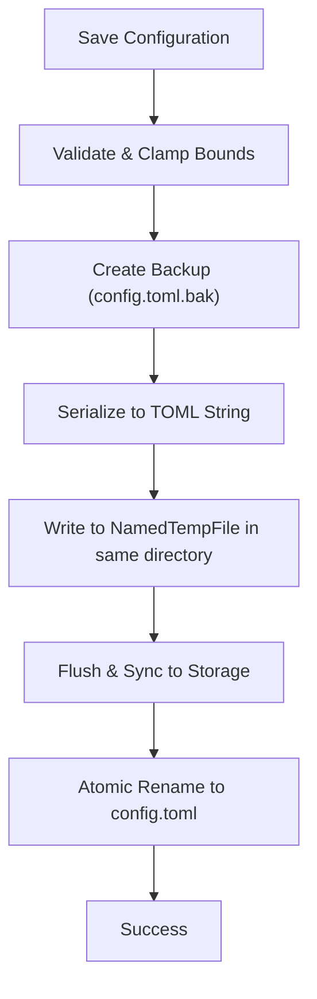

# ⚙️ TermExplorer — Configuration Architecture & Schema Specification (Version 2)

This document provides the complete reference for TermExplorer's central configuration system, schema versioning, validation boundaries, and recovery mechanisms.

---

## 📍 1. File Locations (XDG Specification)

TermExplorer strictly adheres to the FreeDesktop XDG Base Directory Specification:

- **Primary Configuration:** `$XDG_CONFIG_HOME/termexplorer/config.toml` (defaults to `~/.config/termexplorer/config.toml`).
- **Automated Backup:** `$XDG_CONFIG_HOME/termexplorer/config.toml.bak` (created automatically before every write).
- **Corrupted Archive:** `$XDG_CONFIG_HOME/termexplorer/config.toml.corrupted.<timestamp>` (preserved when recovery occurs).
- **Export Destination:** `$XDG_CONFIG_HOME/termexplorer/config_export.toml`.
- **First-Run State:** `$XDG_DATA_HOME/termexplorer/first_run.json` (defaults to `~/.local/share/termexplorer/first_run.json`).

---

## 📜 2. Complete Configuration Reference (Schema Version 2)

```toml
# TermExplorer Workstation Configuration — Schema Version 2
schema_version = 2

[general]
first_run_completed = true       # Set to true once onboarding is completed or skipped
confirm_delete = true            # Prompt before sending files to trash or permanent delete
restore_session = true           # Restore active directory and editor buffers on launch
watch_filesystem = true          # Live inotify filesystem watching and debounced refresh

[layout]
explorer_ratio = 0.25            # File Explorer width ratio (0.15 ..= 0.50, default: 0.25)
preview_ratio = 0.75             # Previewer width ratio (0.50 ..= 0.85, default: 0.75)
terminal_height_percent = 15     # Collapsible PTY drawer height percentage (10 ..= 40, default: 15)
show_terminal = false            # Show embedded PTY terminal drawer on startup (default: false)
show_preview = true              # Show universal contextual preview pane (default: true)
show_sidebar = false             # Deprecated legacy sidebar (default: false)

[theme]
name = "Catppuccin Mocha"        # Theme name: "Catppuccin Mocha", "Catppuccin Macchiato", "Dracula", etc.
accent = "#89b4fa"               # Primary hex accent color (Sapphire/Mauve)
transparent_background = true    # Inherit host terminal emulator transparency (bg: None)

[editor]
tab_width = 4                    # Spaces per indentation tab (2, 4, or 8)
auto_pair = true                 # Automatically insert closing brackets: (), [], {}, "", ''
line_numbers = true              # Display line numbers in the editor left gutter
syntax_highlight = true          # Syntax highlighting using embedded syntect engine
word_wrap = true                 # Soft-wrap long lines in editor viewport
show_completion = true           # Floating word and symbol autocompletion popup

[editor.lsp]
rust_analyzer = "/usr/bin/rust-analyzer"  # Optional path override for rust-analyzer
clangd = ""
pyright = ""
typescript_ls = ""

[terminal]
default_shell = "/bin/bash"      # Path to default interactive shell (detects $SHELL)
terminal_height = 8              # Default rows when drawer is toggled open
scrollback_limit_kib = 1024      # Maximum memory buffer retained for terminal scrollback (KiB)

[search]
case_sensitive = false           # Case-sensitive file and content search
respect_ignore = true            # Respect .gitignore and hidden file exclusion rules

[developer]
git_status_enabled = true        # Real-time Git branch and file modification tracking
task_runner_enabled = true       # Project-aware workflow task execution

[monitor]
refresh_ms = 1000                # Telemetry refresh interval in milliseconds (250 ..= 5000)

[keybindings]
use_defaults = true              # Use central default keyboard shortcut registry

show_hidden = false              # Show hidden dotfiles by default in File Explorer
max_preview_bytes = 524288       # Maximum preview load size in bytes (512 KiB default)
icon_pack = "catppuccin"         # Icon pack: "catppuccin", "nerd_font_mono", "unicode", "ascii", "none"
```

---

## 🛡️ 3. Safe Atomic Storage & Recovery Architecture



### Corruption Recovery Behavior
If `config.toml` fails to parse (e.g. invalid syntax or disk corruption):
1. The corrupted file is **never destroyed**. It is safely renamed to:
   `config.toml.corrupted.<timestamp>`
2. TermExplorer attempts to load and validate `config.toml.bak`.
3. If the backup is valid, it restores it and saves a clean copy.
4. If no valid backup exists, it writes a clean, pristine default configuration and logs a diagnostic warning.

---

## 🔄 4. Schema Migration Pipeline

The `ConfigMigrator` guarantees deterministic schema upgrades:
- **Detection:** Inspects `schema_version` integer in raw TOML.
- **Unversioned (v1) -> Version 2:**
  - Upgrades `schema_version = 2`.
  - Automatically marks `general.first_run_completed = true` so established users are not interrupted.
  - Adds typed `[general]`, `[terminal]`, `[search]`, and `[developer]` tables.
  - Creates backup `config.toml.v1.bak`.
- **Future Version Protection:**
  - If `schema_version > CURRENT_SCHEMA_VERSION`, TermExplorer safely rejects the configuration to prevent overwriting newer settings.
