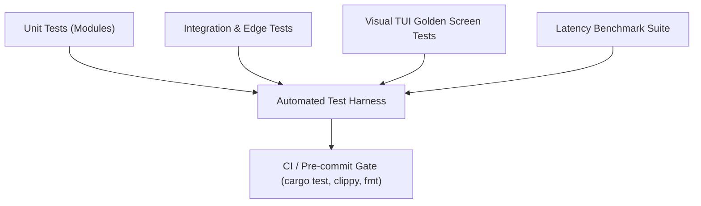

# TermExplorer V1.1.0 — Test Strategy & Verification Methodology

**Author:** TermExplorer Core Engineering Team  
**Standard:** Production Systems Engineering & Automated Verification  

---

## 1. Test Objectives

The TermExplorer verification strategy guarantees:
1. **Zero Unhandled Panics:** Graceful degradation across all I/O errors, missing files, permission denials, and broken symlinks.
2. **Keyboard-First Workflow Integrity:** Every single shortcut, focus switch, panel resize, and navigation action operates deterministically.
3. **Strict Latency Compliance:** Sub-millisecond response for word completion, path resolution, and command palette ranking.
4. **Memory Stability:** Bounded buffer sizes (e.g. 1MB circular PTY buffer, 64-item LRU preview cache) ensuring no memory leaks.
5. **Cross-Terminal Visual Hierarchy:** Correct rendering across standard workstation resolutions (80x24, 100x30, 120x40, 160x50) and terminal emulators.

---

## 2. Test Architecture & Coverage Layers

### Layer 1: Subsystem Unit Tests
- `tests/config_tests.rs`: Configuration serialization, deserialization defaults, pinned folders roundtrip.
- `tests/editor_tests.rs`: Buffer operations, line insertion, auto-indent, auto-pairing brackets/quotes, clipboard, undo/redo stack.
- `tests/filesystem_tests.rs`: Directory listing, hidden file filtering, binary detection, sorting orders, file CRUD operations.
- `tests/theme_tests.rs`: All 4 Catppuccin flavors, canonical hex values, 3-digit hex parsing, TOML loading.
- `tests/icon_tests.rs`: All 5 icon packs, language resolution, category fallback, custom overrides.
- `tests/monitor_tests.rs`: CPU, RAM, disk, network telemetry collection and sparkline updates.
- `tests/plugin_tests.rs`: WASM sandbox loading, permission checks, SHA-256 tampering prevention, host API.

### Layer 2: Adversarial & Edge-Case Tests
- `tests/adversarial_filesystem_tests.rs`:
  - Recursive symlink loop handling (directory pointing to parent).
  - Multi-byte Unicode, emoji, Cyrillic, Kanji filenames.
  - File deletion while open in preview (cache invalidation & graceful recovery).
  - High-density directories (1,500+ files rapid listing).
  - Path traversal protection (`../../etc/passwd`).
- `tests/terminal_edge_tests.rs`:
  - 1MB circular scrollback buffer cap under high-volume streaming.
  - ANSI escape sequences and non-printable key translation.
  - Rapid window resize during streaming.
- `tests/editor_edge_tests.rs`:
  - Auto-pairing closing bracket step-over and pair backspacing.
  - Large pastes (500+ lines) with perfect undo/redo fidelity.
  - Cursor clamping on multi-line navigation.

### Layer 3: Autocomplete & Suggestions Engine Tests
- `tests/autocomplete_tests.rs`:
  - Layer 1 buffer words prefix search.
  - Layer 2 workspace symbol indexer & query across languages.
  - Layer 3 snippet templates (Rust, Python, C, Java).
  - Path and directory completion (`src/con` -> `src/config.rs`, `src/ui/`).
  - Command palette ranking, initials matching (`tdp`), and dynamic navigation (`nav_dir:`).
  - Benchmark assertions (< 20ms buffer words, < 50ms path completion, < 100ms workspace index).

### Layer 4: Visual & Layout Tests
- `tests/ui_visual_tests.rs`:
  - Workstation main layout rendering (120x40): File Explorer (70%), Preview (30%), Bottom Terminal (25%), Header (1), Status Bar (1).
  - Verification that static Workspace sidebar is NOT rendered by default.
  - Fullscreen Preview layout (`F11` / `Z`).
  - Maximized Terminal layout (`Alt+F6` / `Ctrl+Shift+T`).
  - Adaptive breakpoints (80x24 narrow terminal, 60x20 ultra-compact, 160x50 wide workstation).
  - Modal rendering (Command Palette, Settings Studio, Git Workbench, System Gauges).
  - TUI screen buffer captures exported to `screenshots/`.
