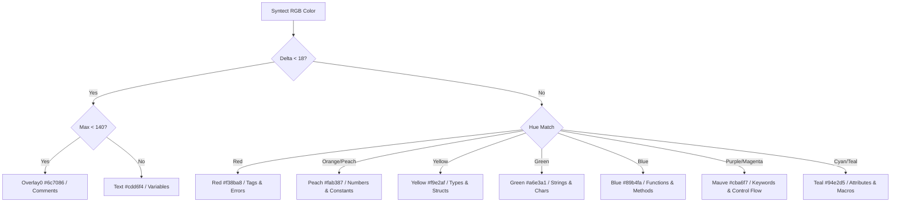

# TermExplorer Syntax Highlighting & Tree-sitter Roadmap

**Module:** `termexplorer::editor::syntax`  
**Architecture Version:** V1.1.0-Sprint 2.1  
**Primary Engine:** Syntect Checkpointed Engine (See [SYNTAX_ENGINE_AUDIT.md](file:///home/prajith/TermExplorer/docs/SYNTAX_ENGINE_AUDIT.md))  
**Theme:** Canonical Catppuccin Mocha  

---

> [!NOTE] Engine Clarification
> Following the comprehensive Sprint 2.1 syntax audit, TermExplorer employs a high-performance **Syntect-based checkpointed regex engine** for syntax tokenization in the quick-edit pane. This provides zero-external-dependency builds, instant out-of-the-box support for 15+ languages, and sub-millisecond render latencies. Tree-sitter is preserved as a roadmap milestone for future structural code refactoring features.

---

## 1. Overview & Architecture

TermExplorer features an incremental syntax highlighting engine designed for terminal workstations. Rather than re-parsing an entire source file on every frame or keystroke, TermExplorer utilizes an **incremental line-level token cache** that only recalculates dirty or newly visible line ranges.

```
┌─────────────────────────────────────────────────────────────┐
│ Highlighting Pipeline                                       │
├─────────────────┬───────────────────┬───────────────────────┤
│ Viewport Request│ Cache Lookup      │ Syntect Parse & Mocha │
│ (start, count)  │ (path_hash, row)  │ Token Transformation  │
│                 │                   │                       │
│ Line 40..80 ───►│ Cache Hit (40..75)│ Cache Miss (76..80)   │
│                 │ Instant O(1)      │ Parse line + Warmup   │
│                 │                   │ Map to Catppuccin     │
│                 │                   │ Store in Cache        │
└─────────────────┴───────────────────┴───────────────────────┘
```

---

## 2. Supported Priority Languages

TermExplorer provides native syntax recognition across all 15 core formats:

| Priority | Language | Extensions | Syntax Grammar Alias |
|---|---|---|---|
| **1** | **Rust** | `.rs` | `Rust` |
| **2** | **Python** | `.py`, `.pyw`, `.python` | `Python` |
| **3** | **C** | `.c`, `.h` | `C` |
| **4** | **C++** | `.cpp`, `.hpp`, `.cc`, `.cxx`, `.c++`, `.h++` | `C++` |
| **5** | **Java** | `.java` | `Java` |
| **6** | **SQL** | `.sql` | `SQL` |
| **7** | **TOML** | `.toml` | `INI` |
| **8** | **Markdown** | `.md`, `.markdown` | `Markdown` |
| **9** | **JSON** | `.json` | `JSON` |
| **10** | **YAML** | `.yaml`, `.yml` | `YAML` |
| **11** | **JavaScript** | `.js`, `.mjs`, `.cjs` | `JavaScript` |
| **12** | **TypeScript** | `.ts`, `.tsx`, `.jsx` | `JavaScript` |
| **13** | **Bash** | `.sh`, `.bash`, `.zsh`, `.fish`, `.ksh` | `Bourne Again Shell (bash)` |
| **14** | **Go** | `.go` | `Go` |
| **15** | **HTML / CSS** | `.html`, `.htm`, `.css`, `.scss`, `.sass` | `HTML` / `CSS` |

---

## 3. Catppuccin Mocha Semantic Color Tokens

Every syntax span emitted by the highlighting engine maps to the canonical Catppuccin Mocha color tokens:

```rust
pub mod mocha {
    pub const BASE: (u8, u8, u8) = (30, 30, 46);     // #1e1e2e (editor background)
    pub const TEXT: (u8, u8, u8) = (205, 214, 244);   // #cdd6f4 (identifiers, default text)
    pub const SUBTEXT0: (u8, u8, u8) = (166, 173, 200); // #a6adc8 (secondary text)
    pub const OVERLAY0: (u8, u8, u8) = (108, 112, 134); // #6c7086 (comments)
    pub const BLUE: (u8, u8, u8) = (137, 180, 250);   // #89b4fa (functions, method names)
    pub const MAUVE: (u8, u8, u8) = (203, 166, 247);  // #cba6f7 (keywords, control flow)
    pub const GREEN: (u8, u8, u8) = (166, 227, 161);  // #a6e3a1 (strings, string literals)
    pub const PEACH: (u8, u8, u8) = (250, 179, 135);  // #fab387 (numbers, constants, booleans)
    pub const YELLOW: (u8, u8, u8) = (249, 226, 175); // #f9e2af (types, structs, classes)
    pub const RED: (u8, u8, u8) = (243, 139, 168);    // #f38ba8 (errors, invalid tokens)
    pub const TEAL: (u8, u8, u8) = (148, 226, 213);   // #94e2d5 (macros, attributes, annotations)
    pub const SKY: (u8, u8, u8) = (116, 199, 236);    // #74c7ec (operators, symbols, fields)
}
```

### Color Mapping Rules



---

## 4. Incremental Line Cache & Dirty Range Tracking

```rust
#[derive(Debug, Clone)]
struct CachedLine {
    line_hash: u64,
    spans: Vec<Span>,
}
```

1. **Hash Verification:** For every row requested in `highlight_viewport`, the content of `lines[row]` is hashed. If the entry in `SYNTAX_CACHE` matches, the rendered spans are returned in $O(1)$ with zero parsing overhead.
2. **Context Warmup:** For newly visible rows, the parser warms up state from `start_row.saturating_sub(100)` to ensure multi-line comments and strings maintain correct state.
3. **Cache Eviction:** The cache is bounded to 8,192 entries, preventing memory bloat during prolonged editing sessions.

---

## 5. Performance Safeguards & Large File Handling

* **Threshold Limit:** Files with more than `MAX_SYNTAX_LINES = 30,000` lines automatically fall back to fast plain-text rendering in Catppuccin `TEXT` color.
* **Typing Latency:** Incremental caching guarantees that typing at the bottom of a 30,000-line file incurs no full-file re-parse overhead, keeping frame times well below 16.6ms (60 FPS).
