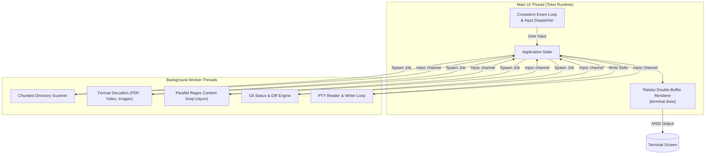

# Concurrency, Async Model & Cancellation Architecture

TermExplorer coordinates asynchronous work using **Tokio** and background OS worker threads.

---

## 1. Concurrency Boundaries

---

## 2. Monotonic Cancellation Tokens

Long-running operations (such as traversing millions of files or compiling video frames) must never block future user interactions:
- Workstation uses `Arc<AtomicU64>` monotonic generation tokens.
- When an operation is superseded (e.g. typing a new search character or navigating to a new directory entry), the token is incremented.
- Workers periodically check if their assigned token equals the current generation. If not, the worker halts immediately and cleans up intermediate memory.

---

## 3. Thread Safety Guarantees

- **No Shared Mutable State**: Workstation state is exclusively owned by the main loop.
- **Message Passing**: Background threads never access GUI or state pointers directly; all results arrive via strongly typed Tokio `mpsc` channels.
- **Panic Isolation**: Background worker thread panics are caught with `std::panic::catch_unwind` and reported as status notifications rather than crashing the primary workstation process.
