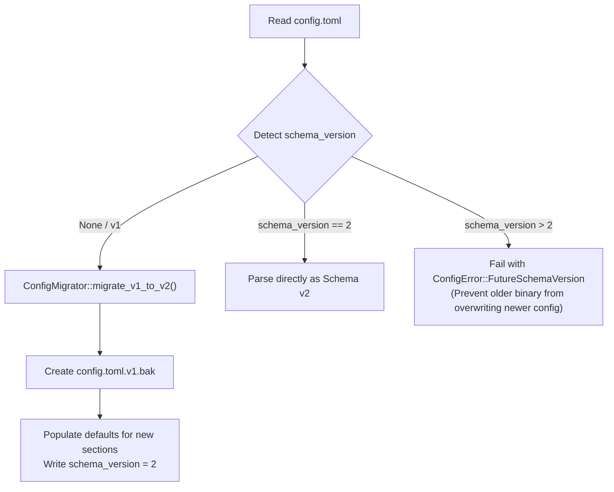

# Configuration & Migration Engine Architecture

The Configuration subsystem (`src/config/`) provides versioned, type-safe settings persistence and migration.

---

## 1. Subsystem Architecture

```text
src/config/
├── mod.rs               # Config, table structs, validation & clamping, save/recover
├── first_run.rs         # FirstRunManager: FreshFirstLaunch, ExistingUser, Upgrade states
└── migration.rs         # ConfigMigrator: schema v1->v2 migration, future-version gating
```

---

## 2. Schema Version 2 Layout

Configuration is stored in `~/.config/termexplorer/config.toml` following Schema Version 2:
```toml
schema_version = 2

[general]
check_for_updates = false
confirm_file_delete = true
restore_session = true
default_workdir = "."
nerd_fonts = true
first_run_completed = true

[layout]
preview_ratio = 0.75
explorer_ratio = 0.25
terminal_height_percent = 15
dual_pane = false
show_sidebar = false

[theme]
name = "Catppuccin Mocha"
transparent_background = true
active_border_color = "#89b4fa"
inactive_border_color = "#45475a"

[editor]
tab_width = 4
auto_pair = true
line_numbers = true
syntax_highlight = true
word_wrap = true
show_completion = true

[terminal]
default_shell = ""
login_shell = true
scrollback_limit_kib = 1024
copy_on_select = false

[search]
max_results = 1000
case_sensitive = false
follow_symlinks = false
smart_case = true

[developer]
auto_detect_project = true
watch_git = true
telemetry_rate_ms = 1000

[monitor]
refresh_ms = 1000

[keybindings]
preset = "default"
```

---

## 3. Migration Pipeline & Backward Compatibility



---

## 4. Resilience & Corruption Recovery

When loading configuration:
1. If file does not exist, writes clean Schema v2 default configuration.
2. If file contains invalid TOML syntax or corrupted bytes:
   - Copies file to `config.toml.corrupted.<timestamp>`.
   - Generates and saves fresh default configuration.
   - Alerts user via status notification indicating the archive location.
3. Every write operation writes to a temporary file (`.tmp.<pid>`), flushes with `sync_all()`, copies original to `.bak`, and executes an atomic POSIX rename.
