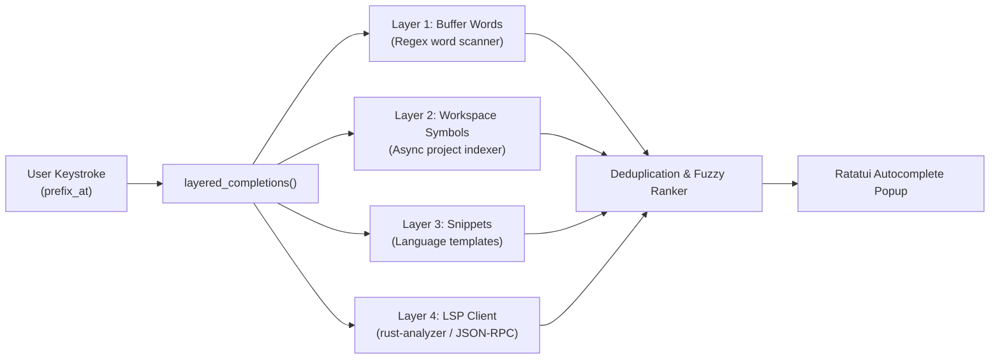

# Editor Architecture & Rope Buffer Model

The Integrated Code Editor (`src/editor/`) provides a fast, memory-efficient text editing environment backed by a B-tree rope structure.

---

## 1. Rope Data Structure (`ropey::Rope`)

Rather than storing text in a contiguous string buffer (which requires $O(N)$ reallocations and copies on every insertion), TermExplorer uses `ropey::Rope`:
- Text is structured as a balanced B-tree of string chunks.
- Insertions and deletions execute in $O(\log N)$ time regardless of file length.
- Memory consumption scales linearly with file size without requiring massive contiguous allocation arenas.

---

## 2. Unicode Coordinate Systems

Terminal character manipulation requires careful distinction between coordinate models:

| Coordinate Type | Unit | Purpose in TermExplorer |
|---|---|---|
| **Byte Index** | `usize` bytes | Slicing raw UTF-8 strings for disk I/O and syntax tokenization |
| **Char Index** | `usize` code points | Internal rope indexing and cursor character offsets |
| **Grapheme Cluster** | `unicode_segmentation` | Visual cursor positioning across compound emojis (e.g. `👨‍👩‍👧‍👦`) and combining accents |
| **Display Width** | `unicode_width` | Screen columns occupied in Ratatui terminal rendering (handles fullwidth CJK characters) |

Converting between coordinate spaces is handled by `Cursor::to_char_index()` and `Buffer::char_to_byte_index()`, ensuring cursor movement never splits a multibyte sequence.

---

## 3. Transactional Undo/Redo Engine

Undo history is tracked as reversible delta operations:
- **`Insert { pos, text }`**: Inserting text is reversed by deleting the inserted span.
- **`Delete { pos, text }`**: Deleting text is reversed by re-inserting the deleted text.
- **Transaction Grouping**: Consecutive typing keystrokes within a 500 ms window are coalesced into a single logical undo transaction, preventing hundreds of individual single-character undo steps.
- **Undo Limit**: Retains up to 300 undo transactions per buffer.

---

## 4. Syntax Highlighting & Token Caching

Syntax highlighting uses `syntect` with Sublime/TextMate syntax definitions:
- **Viewport Bounded**: Only lines currently visible on the screen are tokenized during render frames.
- **State Caching**: The parser saves scope states at periodic line intervals, enabling instantaneous jumping to arbitrary lines without re-parsing from line 0.

---

## 5. Autocomplete Architecture

