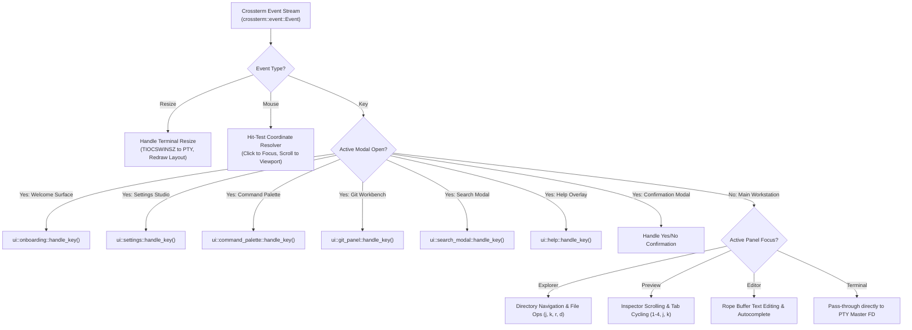

# Event System & Input Routing Architecture

TermExplorer implements a hierarchical modal event dispatching system designed to avoid shortcut collisions and input lockups.

---

## 1. Event Ingestion Pipeline

---

## 2. Modal Hierarchy and Dispatch Priority

Modals in TermExplorer always take strict precedence over background panel keys:
1. **Critical Safety Confirmation**: Discard changes, permanent deletion, trust prompts.
2. **First-Run Welcome Surface**: Blocks underlying panel navigation until dismissed.
3. **Command Palette & Search**: Consumes alphanumeric input for fuzzy filtering.
4. **Settings Studio**: Consumes column navigation and value adjustment keys.
5. **Git Workbench**: Dedicated staging, commit, and diff inspection.
6. **Active Focus Panel**: Explorer, Preview, Editor, or Terminal.

Pressing `Esc` universally closes the topmost modal and returns keyboard focus to the File Explorer.

---

## 3. Mouse Hit-Testing & Interaction

TermExplorer enables mouse capture (`EnableMouseCapture`) for intuitive mouse interactions:
- **Click to Focus**: Clicking anywhere within a panel's bounding box moves focus directly to that panel.
- **Mouse Wheel Scrolling**: Scrolling over the Explorer lists scrolls directory entries; scrolling over the Preview pane scrolls preview content; scrolling over the editor adjusts text lines.
- **Tab Clicks**: Clicking on Preview tabs (`[Preview]`, `[Information]`, `[Hex]`, `[Actions]`) switches tabs immediately.
