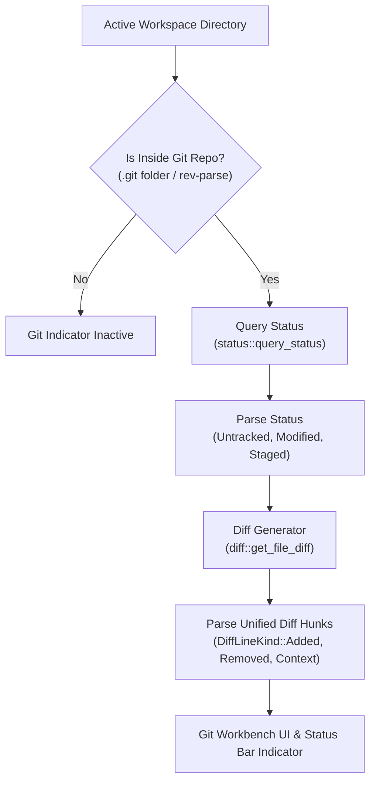

# Git Integration Architecture

The Git subsystem (`src/git/`) embeds version control awareness into TermExplorer without adding unnecessary GUI complexity.

---

## 1. Subsystem Architecture

```text
src/git/
├── branch.rs            # Branch listing, creation, and checkout operations
├── commit.rs            # Commit authoring and amending
├── diff.rs              # Unified diff parser and line classification
├── history.rs           # Commit log parsing and file blame
├── manager.rs           # GitOperationManager: background refresh and polling
├── status.rs            # Working-tree status evaluation (staged vs unstaged)
└── types.rs             # Typed models (GitRepoStatus, GitDiffHunk, GitCommitInfo)
```

---

## 2. Status Evaluation & Diff Pipeline



---

## 3. Staging and Commit Workflow

- **Staging (`stage_file`)**: Executes `git add <path>` to update the Git index.
- **Unstaging (`unstage_file`)**: Executes `git restore --staged <path>` to return files to unstaged status without altering working-tree contents.
- **Commit Creation (`create_commit`)**: Authoring a commit requires explicit user confirmation. TermExplorer calls `git commit -m "<message>"`, ensuring standard git hooks (`pre-commit`, `commit-msg`), GPG/SSH signing, and author configurations are respected.

---

## 4. Credential Safety & Non-Interactive Invariant

TermExplorer never prompts for credentials on standard input in ways that would stall the TUI:
- Background git status queries set `GIT_TERMINAL_PROMPT=0` to ensure commands fail cleanly rather than blocking on credential prompts.
- All credential operations are deferred to system credential helpers (e.g. `git-credential-libsecret` or SSH agents).
