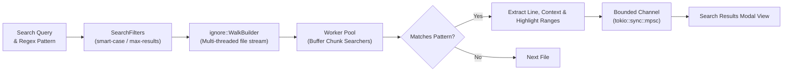

# Search Subsystem & Parallel Regex Architecture

The Search Subsystem (`src/search/`) powers both fuzzy file path search and project-wide content grep.

---

## 1. Subsystem Architecture

```text
src/search/
├── cancellation.rs      # SearchCancellation atomic token
├── content_search.rs    # Parallel ripgrep-style content grep
├── engine.rs            # SearchEngine coordinator & mode manager
├── file_search.rs       # Fuzzy filename matching with scoring
├── filters.rs           # SearchFilters (case sensitivity, ignore rules)
└── history.rs           # Search query history & recency ranking
```

---

## 2. Ignore Rule Enforcement & Traversal

Searching project directories must avoid scanning ignored files (`target/`, `node_modules/`, `.git/`):
- Uses the `ignore::WalkBuilder` crate.
- Automatically reads and merges `.gitignore`, `.ignore`, and global git ignore configurations.
- Runs traversal across a rayon/tokio thread pool for maximum disk I/O throughput.

---

## 3. Parallel Content Search Pipeline



---

## 4. Atomic Cancellation & Query Throttling

During interactive typing:
- Every new character entered into the search modal resets the `SearchCancellation` atomic boolean flag (`Arc<AtomicBool>`).
- Background worker threads inspect this flag inside tight scanning loops.
- When cancelled, workers exit immediately without processing remaining files or allocating match objects.
- Result buffers are capped at `max_results` (default 1,000; clamped between 10 and 50,000) to keep memory usage bounded.
