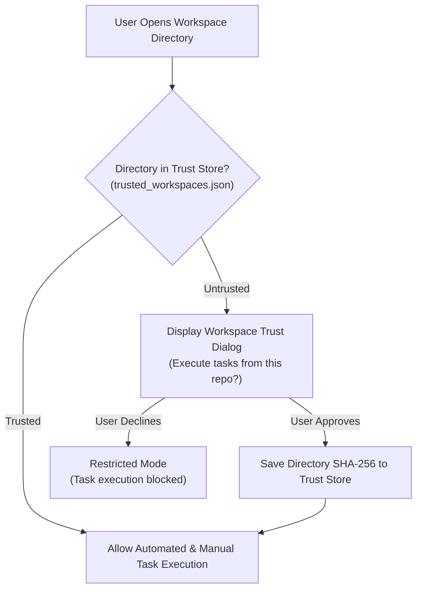

# Task Runner & Workflow Engine Architecture

The Workflow Engine (`src/workflow/`) coordinates project detection, task configuration, dependency resolution, execution streaming, and workspace trust enforcement.

---

## 1. Subsystem Architecture

```text
src/workflow/
├── command.rs           # Command palette registry, categorization, recency ranking
├── config.rs            # load_project_tasks / save_project_tasks (.termexplorer/tasks.toml)
├── dag.rs               # TaskDag: cycle detection & topological scheduling
├── detect.rs            # detect_project: Cargo, npm, Python, Go stack discovery
├── runner.rs            # TaskRunner: child process spawning, async line streaming
├── tasks.rs             # TaskDefinition, TaskStatus, variable substitution
└── trust.rs             # WorkspaceTrustStore: persistence & default-deny boundary
```

---

## 2. DAG Scheduling & Topological Sorting (`dag.rs`)

When tasks declare dependencies via `depends_on = ["build"]`:
1. `TaskDag` constructs a directed acyclic graph of task nodes.
2. Runs Kahn's algorithm or DFS cycle detection. If a cyclic dependency is detected (e.g. `A -> B -> A`), execution is rejected with `DagError::CyclicDependency`.
3. Valid tasks are topologically sorted to determine execution sequence.

---

## 3. Streaming Process Supervision (`runner.rs`)

When a task executes:
- Spawns child process using Tokio's asynchronous `tokio::process::Command`.
- Stdout and stderr streams are merged or tagged (`TaskOutputStream::Stdout`, `Stderr`).
- Streams are read line by line and published over an asynchronous channel (`TaskRunnerEvent::Line`).
- If a timeout occurs (`timeout_secs`), `TaskRunner` sends `SIGTERM` followed by `SIGKILL` to prevent orphan child processes.

---

## 4. Workspace Trust Boundary (`trust.rs`)


