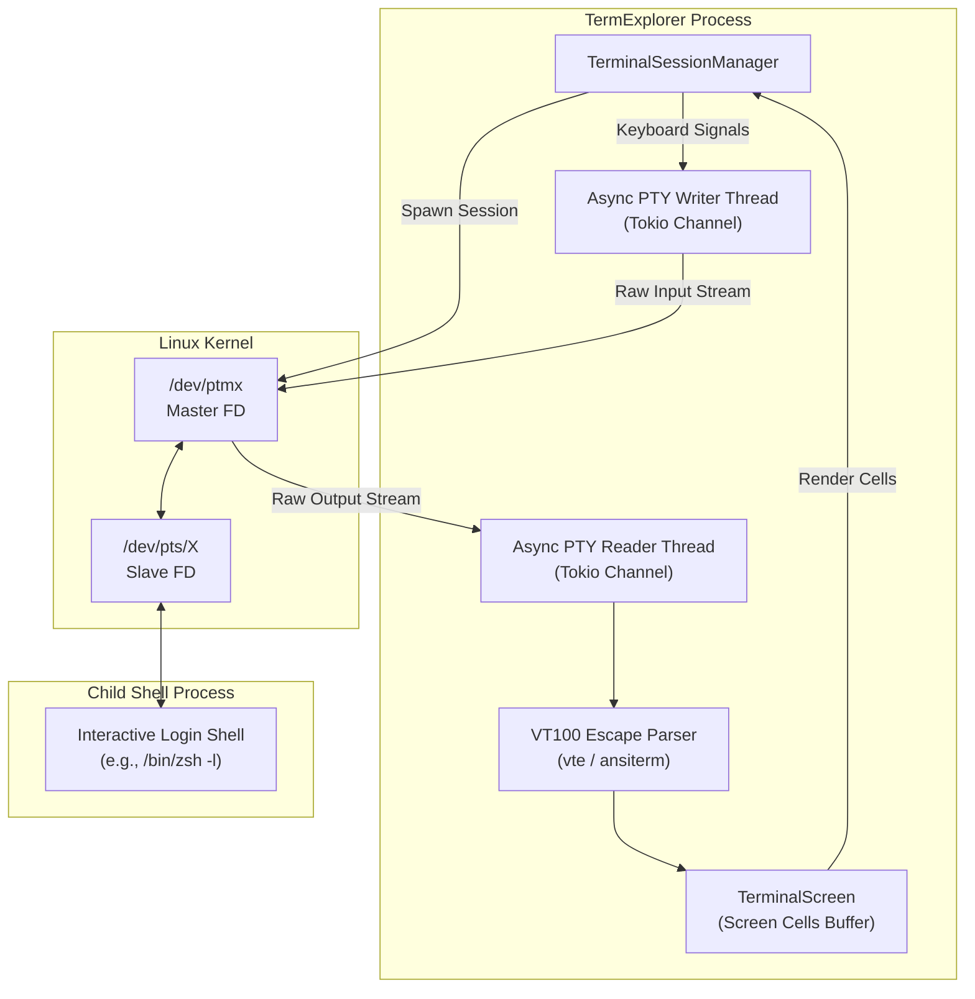

# Embedded PTY & Terminal Architecture

The Shell subsystem (`src/shell/`) embeds an interactive Linux pseudo-terminal inside TermExplorer.

---

## 1. Subsystem Architecture

```text
src/shell/
├── detection.rs         # TerminalCapabilities, shell discovery, CLI tool integrations
├── input.rs             # Terminal input encoding & escape sequence translation
├── manager.rs           # TerminalSessionManager: multi-session supervision & lifecycle
├── pty.rs               # portable-pty integration, PTMX open, slave spawn
├── session.rs           # TerminalSession: async worker threads, channel bridges
└── terminal_screen.rs   # In-memory VT100 screen buffer & cursor representation
```

---

## 2. Process & PTY Supervision



---

## 3. Asynchronous I/O Isolation

A critical design requirement is that high-volume terminal output (e.g. running `find /` or rapid compiler output) must never stall the application event loop:
1. **Dedicated Reader Thread**: Reads bytes from the PTY master descriptor in a separate blocking thread.
2. **Channel Decoupling**: Bytes are transferred over bounded `tokio::sync::mpsc` channels.
3. **Screen Buffer Updating**: The `TerminalScreen` updates its internal character cell matrix on thread messages.
4. **Ratatui Rendering**: During `terminal.draw()`, Ratatui simply reads the cells currently in `TerminalScreen` without performing any disk or PTY reads.

---

## 4. Window Resizing via `TIOCSWINSZ`

When the user adjusts terminal drawer height or resizes the host terminal emulator:
1. TermExplorer computes the new drawer dimensions `(cols, rows)`.
2. The PTY manager invokes `pty_pair.master.resize(PtySize { rows, cols, pixel_width: 0, pixel_height: 0 })`.
3. Under the hood, this executes `ioctl(master_fd, TIOCSWINSZ, &winsize)`.
4. The kernel sends a `SIGWINCH` signal to the child shell process, prompting it to reflow lines and notify curses applications (`vim`, `htop`, `tmux`).
