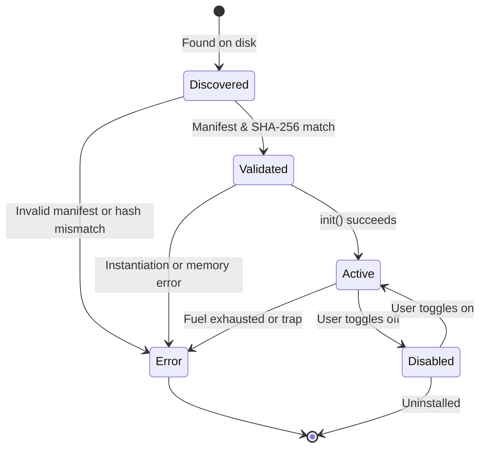

# Plugin Lifecycle & Failure Handling

This document details the lifecycle stages of a WebAssembly plugin in TermExplorer.

---

## 1. Lifecycle States (`PluginState`)

A plugin moves through four distinct states during its lifecycle:

- **`Discovered`**: Manifest file `plugin.toml` detected in plugin search paths.
- **`Active`**: Wasm bytecode verified, linked, instantiated, and `init()` succeeded.
- **`Disabled`**: Present and valid, but paused by user configuration in Settings or Plugin Center.
- **`Error(String)`**: Failed integrity check, exceeded fuel/memory limit, or encountered a WebAssembly trap.

---

## 2. Discovery Directories

TermExplorer scans two locations for plugins:
1. **Bundled Plugins**: `./plugins/` relative to the workspace root.
2. **User Plugins**: `~/.local/share/termexplorer/plugins/` (or `$XDG_DATA_HOME/termexplorer/plugins/`).

---

## 3. Trap & Fault Isolation

If a plugin encounters an arithmetic overflow, memory violation, or reaches its fuel limit:
- `wasmi` produces a `Trap` error.
- TermExplorer catches the error cleanly within `PluginInstance`.
- The plugin state transitions to `PluginState::Error("...")`.
- The error is logged to `termexplorer.log`, and an error banner is shown to the user.
- Other active plugins and all core workstation features continue running without interruption.
